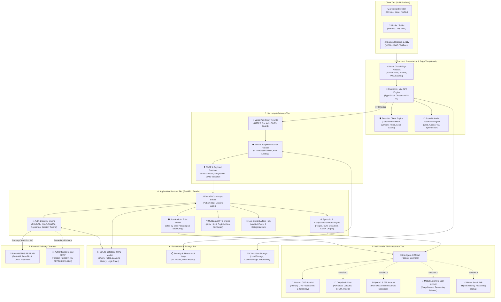
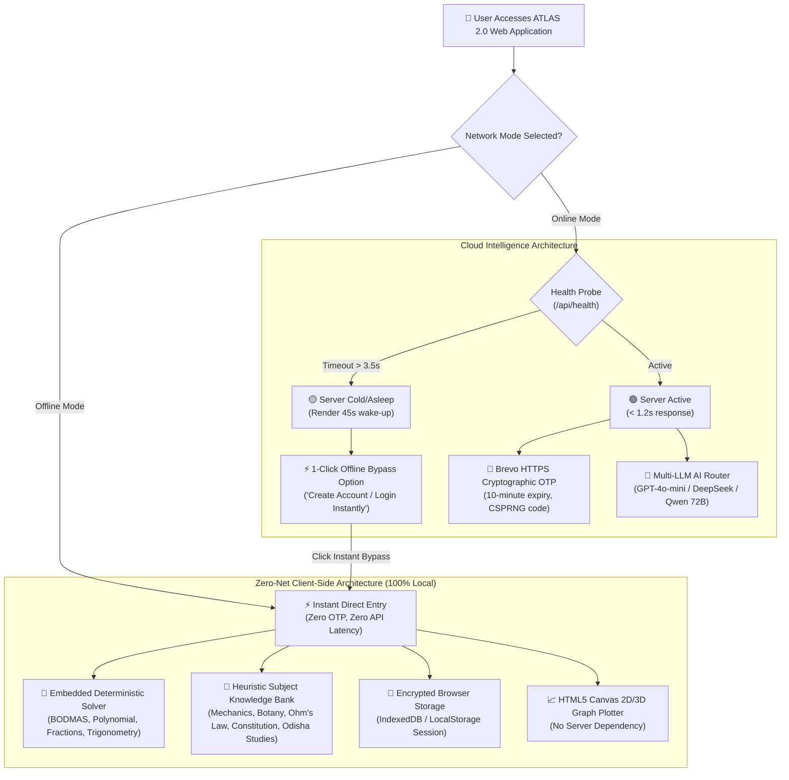
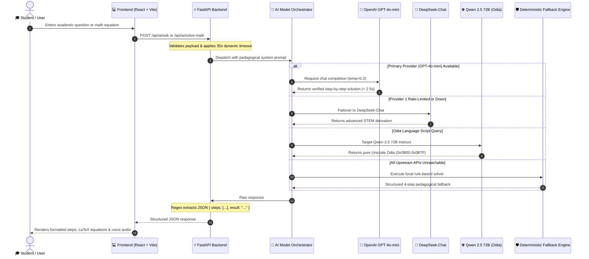
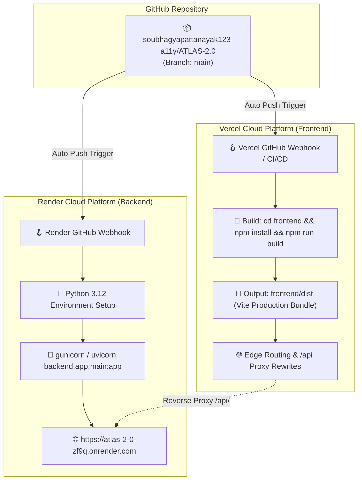

# ATLAS 2.0: Full System Architecture Specification

This document provides the definitive, end-to-end architecture blueprint for **ATLAS 2.0 (Accessible Academic Learning & Computational Intelligence Platform)**. It includes comprehensive Mermaid architectural diagrams, data flows, security topologies, and deployment infrastructure models.

---

## 1. High-Level System Architecture

The following diagram illustrates the complete end-to-end topology across Client Devices, Edge Frontend CDN, Gateway & Security Layers, Core Backend Services, AI Intelligence Pipelines, and Data Stores.

---

## 2. Dual-Mode Architecture: Online Cloud vs. Zero-Net Offline

ATLAS 2.0 employs an architectural model guaranteeing that **no student is ever locked out** due to slow network, rural bandwidth constraints, or cloud server cold starts.

---

## 3. Security, Authentication & Cryptographic Topology

The security perimeter of ATLAS 2.0 is built on defense-in-depth principles:

```mermaid
flowchart LR
    subgraph ClientShield["Client Shield"]
        InMemoryToken["🛡️ In-Memory Token Shield\n(Mitigates XSS Token Theft)"]
        SessionStore["🔒 SessionStorage Fallback"]
    end

    subgraph NetworkShield["Network & Transport Shield"]
        HTTPSOnly["🔐 Strict HTTPS Transport\n(TLS 1.3 Encryption)"]
        CORSSecurity["🌐 Origin Isolation\n(Strict CORS Allowed Origins)"]
    end

    subgraph FirewallCore["Adaptive Application Firewall"]
        RateLimiter["⏱️ Rate Limiter (60s OTP Cooldown)"]
        IPBlocklist["🚫 Dynamic IP Blacklist Engine"]
        MIMEInspection["🔍 Magic Byte MIME Verifier\n(PNG, JPEG, WebP, PDF)"]
        SSRFBlock["🛡️ RFC1918 Private IP Filter\n(Blocks 127.0.0.1, 10.x, 192.168.x)"]
    end

    subgraph CryptoStore["Cryptographic Credential Storage"]
        SaltPepper["🧂 CSPRNG Salt + Server-Side Pepper (256-bit)"]
        HashFunction["🔑 PBKDF2-HMAC-SHA256\n(100,000 Iterations)"]
        DBStore["🗄️ SQLite Users Table"]
    end

    ClientShield --> NetworkShield
    NetworkShield --> FirewallCore
    FirewallCore --> CryptoStore
    CryptoStore --> DBStore
```

---

## 4. Multi-LLM AI Academic & Math Orchestration Flow

---

## 5. Deployment & Infrastructure Architecture

---

## 6. Component Directory & Responsibility Mapping

| Layer | Primary Files | Architectural Responsibility |
| :--- | :--- | :--- |
| **Frontend Presentation** | [`frontend/src/App.tsx`](file:///c:/Users/soubh/OneDrive/Desktop/ATLAS%202.0/frontend/src/App.tsx), [`LoginPage.tsx`](file:///c:/Users/soubh/OneDrive/Desktop/ATLAS%202.0/frontend/src/components/LoginPage.tsx) | User experience, authentication UI, smart offline mode toggle, responsive layouts |
| **Frontend State & API** | [`frontend/src/api.ts`](file:///c:/Users/soubh/OneDrive/Desktop/ATLAS%202.0/frontend/src/api.ts) | Unified HTTP client, 35s adaptive timeout, client-side offline solvers, script normalizer |
| **Backend Core & Routing** | [`backend/app/main.py`](file:///c:/Users/soubh/OneDrive/Desktop/ATLAS%202.0/backend/app/main.py) | FastAPI application lifecycle, REST endpoints, CORS/Firewall registration, error handlers |
| **AI Academic Engine** | [`backend/app/ai_tutor.py`](file:///c:/Users/soubh/OneDrive/Desktop/ATLAS%202.0/backend/app/ai_tutor.py), [`ai_service.py`](file:///c:/Users/soubh/OneDrive/Desktop/ATLAS%202.0/backend/app/ai_service.py) | Multi-model failover orchestrator (GPT-4o-mini, DeepSeek, Qwen), regex JSON parsing |
| **Email Dispatch** | [`backend/app/email_service.py`](file:///c:/Users/soubh/OneDrive/Desktop/ATLAS%202.0/backend/app/email_service.py) | Brevo HTTPS Port 443 cloud fast-path (<1s) with authenticated Gmail SMTP fallback |
| **Security & Firewall** | [`backend/app/firewall.py`](file:///c:/Users/soubh/OneDrive/Desktop/ATLAS%202.0/backend/app/firewall.py), [`security_utils.py`](file:///c:/Users/soubh/OneDrive/Desktop/ATLAS%202.0/backend/app/security_utils.py) | Adaptive IP blacklist, SSRF protection, MIME validation, CSPRNG salting/peppering |
| **Persistence** | [`backend/app/database.py`](file:///c:/Users/soubh/OneDrive/Desktop/ATLAS%202.0/backend/app/database.py), [`crud.py`](file:///c:/Users/soubh/OneDrive/Desktop/ATLAS%202.0/backend/app/crud.py) | SQLite connection pool with WAL mode enabled, atomic transactions, schema migrations |
